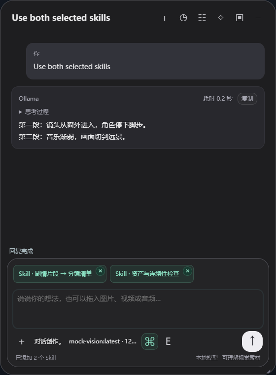
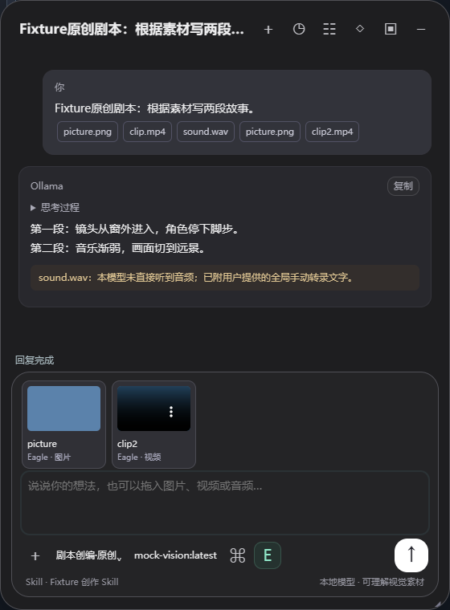
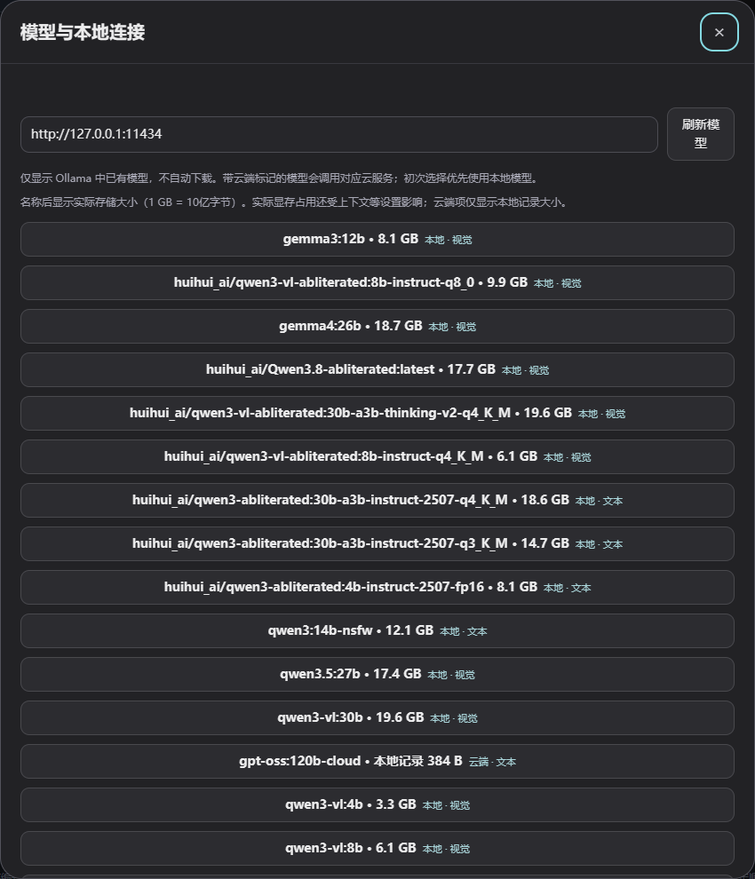
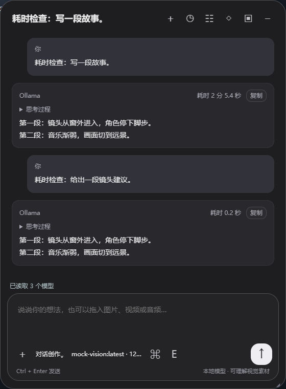
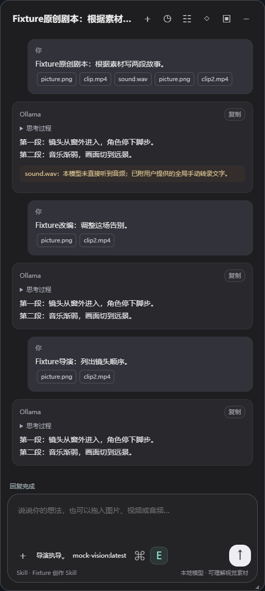
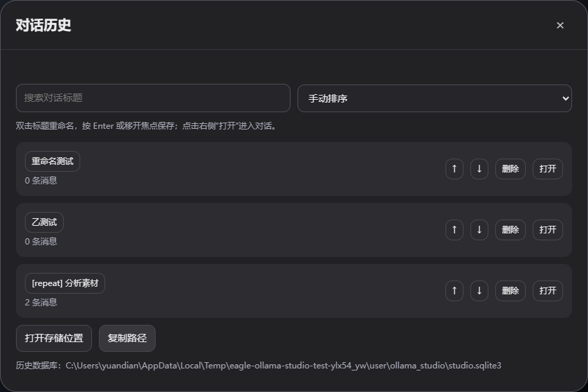
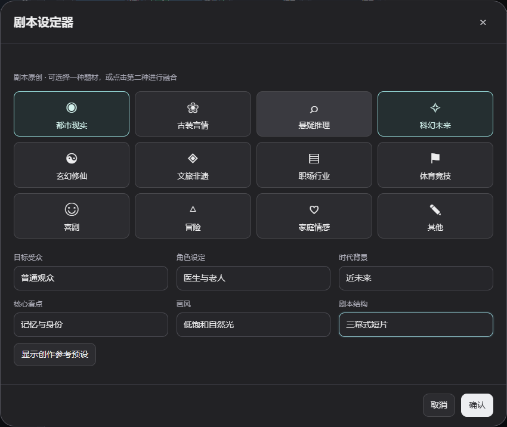
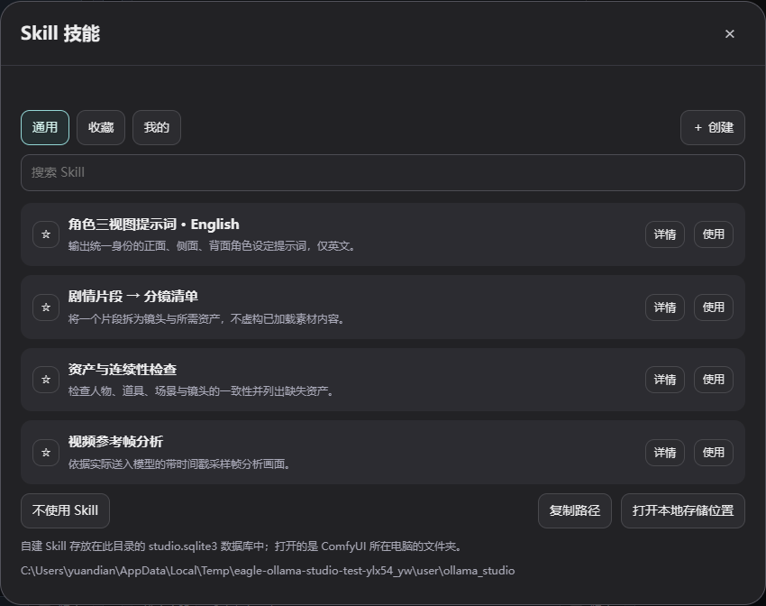
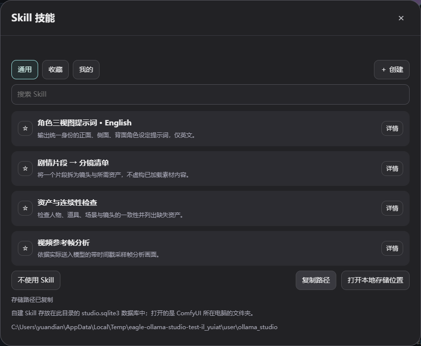
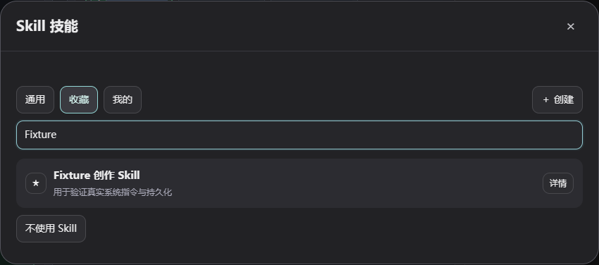

# Ollama 创作台 1.4.0 · ComfyUI 浮窗插件

连接 ComfyUI 后端所在电脑的 Ollama，用可拖拽浮窗完成对话创作、剧本创编和导演执导。支持图片 / 视频 / 音频上传、Eagle 素材桥、历史对话，以及可编辑的提示词规范 Skill。

1.4.0 在 E 旁边增加 **Z** 开关，独立控制图片直连素材桥。默认关闭，开启时显示与 E 相同的绿色高亮，并自动加入图片桥预览中选中的图片；关闭后撤回直连素材，开关状态记忆在当前浏览器。搭配 EagleAssets 2.7.0，LoadImage 连接或换图后即可自动读取，无需点击队列；尚未生成的图片需先生成。图片桥默认全选，点击可排除单张，实际发送也遵循选择。Z 不控制 E、拖入的文件或已发送的历史消息。

1.3.0 支持 EagleAssets 2.6.0 的 **图片直连素材桥 · Ollama**。将图片输出接到该节点并执行工作流，图片按接口编号与批次顺序加入创作台，无需开启 E 或配置 Eagle。素材展示、模型实际接收、大图左右切换的顺序统一为：**拖拽/直接上传 → 图片直连素材桥 → Eagle 创作素材桥**。E 开关仍只控制原有 Eagle 素材；直连图片引用随当前工作流切换，更改连线后需重新执行节点。

1.2.1 的素材查看器加入左右箭头、当前序号及键盘左右方向键。输入框素材按“直接上传在前、Eagle 素材在后”的现有顺序切换，历史消息按该条消息的附件顺序切换；到达首尾时对应箭头禁用。切换音视频会停止上一个素材，切换模型会释放之前的渲染资源，无需反复关闭窗口。

1.2.0 支持同时添加多个 Skill。列表按钮改为“添加 / 已添加”，添加后面板保持打开，可连续添加；点击弹窗外侧、关闭按钮或 Esc 退出。输入框上方按添加顺序显示绿色 Skill 标签，右上角 × 只移除本次引用，不删除 Skill。模型会收到全部已添加的规范；发生冲突时后添加的规范优先。多项选择会随本地设置及对话消息保存，旧版单项选择自动兼容。



1.1.0 修复浮窗移动时反复重算工作流画布尺寸的问题；加入重复输出保护、素材双击查看、Skill 一键使用与绿色状态提示，以及历史标题改名 / 搜索 / 排序 / 存储位置入口。与 EagleAssets 2.3 配合使用。

1.0.4 在 Skill 面板底部加入“打开本地存储位置”和“复制路径”。前者打开 ComfyUI 所在电脑上保存 `studio.sqlite3` 的文件夹，并跟随自定义用户目录；界面同时显示实际路径。无桌面环境时可复制路径手动访问。

1.0.3 在每条模型回复顶部显示从点击发送到回复完成的总耗时，如“耗时 12.3 秒”或“耗时 2 分 5.4 秒”。包含发送后的素材处理、模型加载、思考和生成时间，随历史对话保存。停止或失败时标明状态及已耗时间；旧历史没有计时数据时显示“耗时未记录”。

1.0.2 在模型列表及当前模型名称后显示 Ollama 返回的实际存储大小，如 `gemma3:12b · 8.1 GB`。按十进制 GB / MB 换算；未提供有效数值时显示“大小未知”，云端模型的数值标为“本地记录”。存储大小可作粗略参考，实际显存占用还受上下文等设置影响。

包含 1.0.1 的浮球修复：固定圆球尺寸，与欢迎页使用相同的彩色渐变；点击仍可恢复浮窗。覆盖更新后按 **Ctrl + F5**。



## 安装

1. 解压 `ComfyUI-OllamaStudio.zip`，将 `ComfyUI-OllamaStudio` 文件夹放到实际 ComfyUI 的 `custom_nodes` 下。
2. Eagle 配套功能需要同时更新 `ComfyUI-EagleAssets` 至 2.3。覆盖原文件夹，避免安装同一插件的多个副本。
3. 启动 Ollama，重启 ComfyUI，浏览器 **Ctrl + F5**。首次打开显示创作浮窗；关闭后可点击画面下方中央的彩色小球重新打开。
4. 默认 Ollama 地址为 `http://localhost:11434`，可在 **选择模型**中修改并刷新。模型列表来自已安装的模型，本插件不会自动拉取模型。

请求通过 ComfyUI 后端转发，浏览器无需配置 Ollama CORS。这里的 localhost 指 **ComfyUI 后端所在电脑**；浏览器和 ComfyUI 分别在两台电脑时，需要填写后端能够访问的 Ollama 地址。

模型名称后的大小随 **刷新模型**更新；底部当前模型按钮也显示该大小，名称过长时可悬停查看完整信息。



ComfyUI 通常已有 aiohttp、Pillow。缺少时，用实际 ComfyUI 的 Python 安装 `requirements.txt`。视频分析使用 PyAV 或 PATH 中的 FFmpeg / FFprobe。便携版应使用自己的 `python_embeded/python.exe`。

## 浮窗与对话

- **新对话**创建独立对话；**历史对话**切换或删除已保存对话。历史中保存消息、所用创作身份、Skill 和模型。
- 拖动上方标题区域移动整个浮窗，拖动角落调整大小。
- **停靠右侧**将面板移到 ComfyUI 右侧，再点恢复浮动。**关闭**缩成固定在下方中间的小球。
- 将图片、视频、音频或剧本文本拖到浮窗任意区域，会加入底部素材栏；也可用 **添加文件**。上传完成后可播放音视频或移除附件。
- **发送**开始流式生成，**停止**取消当前生成；回复可直接复制。Ctrl + Enter 也可发送。
- 每条回复顶部显示总耗时，刷新或切换历史对话后仍保留。旧回复没有原始计时数据，显示“耗时未记录”。
- 底部图片、视频、音频卡片及历史消息中的素材名称可双击放大查看；关闭预览可回到对话。3D 素材在安装配套 EagleAssets 且格式受支持时可预览，否则提供下载入口。





## 重复输出保护

模型请求使用适度的重复惩罚，并在流式回复中检测持续重复的尾段。发现明显循环时主动结束生成，去掉多余循环并保留前文，显示“重复保护”及提示；历史中保留相同结果。这用于阻止持续刷屏，模型内容本身的正确性仍取决于模型。

旧历史如果已有很长的重复尾段，后续请求会省略该重复部分，避免继续污染上下文；数据库中的旧回复原文不改写。

默认单次输出上限为 8192 token（包含模型实际计入的思考输出）。到达上限会明确提示，后续可发送“继续”。需要长篇剧本时，可在用户目录的 `ollama_studio/config.json` 中设置 `"max_output_tokens": 16384`，允许范围 256–65536；如确实需要模型刻意重复，可设置 `"repetition_guard": false`。已有音频转录配置可保留在同一 JSON 对象中。

参数参考：[Ollama 官方运行参数](https://docs.ollama.com/modelfile#valid-parameters-and-values)。

## 历史对话管理

历史面板支持标题搜索，按更新时间、创建时间、标题、消息数量排序，也可选“手动排序”用上下箭头调整顺序。排序偏好保存在当前浏览器。

双击标题进入编辑，Enter 或移开焦点保存，Esc 取消；单击标题不再直接打开对话。每行的“删除”后有独立“打开”按钮。底部显示实际历史数据库位置，并提供“打开存储位置”和“复制路径”。历史与 Skill 共用 `studio.sqlite3`，位于 ComfyUI 用户目录的 `ollama_studio` 文件夹。



## Eagle 素材桥

连接方式：

```text
Eagle 多目录媒体导入 · media_catalog → Eagle 创作素材桥 · media
```

`media_catalog` 是新加入的第 5 个输出端口，包含当前加载目录的完整素材预览；前四个图片 / 视频 / 音频 / 模型集合仍保持原来的端口位置。旧工作流会自动补上第 5 口。

1. 在导入节点选择目录和媒体类型，加载预览。
2. 素材桥中点击选择，再点一次取消，绿色编号是选择顺序。
3. 浮窗下方点击 **开启 Eagle 素材**。所选素材按编号加入，始终排在直接上传的文件后面。

素材桥可以读取未在导入节点中标记输出的素材，无需先拆分媒体，也无需运行整个工作流才能选择。切换工作流后只读取当前工作流的桥节点。Eagle 目录引用过期时，刷新导入预览即可更新；已锁定的本地快照也可以作为素材来源。

示例见 EagleAssets 的 `examples/studio-bridge-workflow.json`。

## 创作模式

默认 **对话创作**。**剧本创编**包含 **原创剧本**与 **故事改编**两个分支，设定器支持一至两种题材融合，并设置目标受众、角色、时代背景、核心看点、画风和剧本结构。改编可填写原故事及改编方向，也可上传 TXT / Markdown 等故事文件。

**导演执导**使用导演身份，围绕镜头语言、调度、画面、剪辑和声音设计回答。设置会实际进入模型的系统提示词，并随该条对话保存。题材预设是创作模板，不代表平台热度或真实市场数据。



## Skill 提示词规范

Skill 面板提供 **通用 / 收藏 / 我的**、搜索、详情和创建。内置规范可直接选用，也可复制详情中的文字，另建自己的版本；自定义规范可编辑、删除，收藏保存在当前浏览器。

每行“详情”后有直接“使用”按钮。启用后，底部 Skill 图标与素材列表上方的 Skill 名称会以绿色亮起；选择“不使用 Skill”可取消。详情页仍可查看完整规则后使用。



面板底部的 **打开本地存储位置** 打开自建 Skill 数据库所在文件夹；**复制路径** 可复制实际目录。路径跟随 ComfyUI 用户目录配置。浏览器和 ComfyUI 不在同一台电脑时，打开的是 ComfyUI 后端所在电脑的文件夹。



内置 **角色三视图提示词 · English** 要求只用英文输出角色身份描述、完整生成提示词和负面提示词，并规定正 / 侧 / 背三视图的排列、比例、姿态与身份一致性。其余内置规范涵盖分镜清单、资产连续性检查和视频参考帧分析。

选择 Skill 后，其具体规范会追加到系统提示词。模型输出质量仍取决于模型本身；这是文本提示词创作功能。



## 媒体理解方式

| 素材 | 实际提供给模型的内容 |
| --- | --- |
| 图片 | 真实图片，缩放为适合分析的视觉输入 |
| 视频 | 最多 8 张等距采样帧及真实时间戳；声音需另行转录 |
| 音频 | 本地 faster-whisper 的转录文字，或你填写的手动转录 |
| 3D 模型 | 文件格式、大小等真实元数据；OBJ 还提供顶点与面数量 |
| 文本 | 文件内容，较长内容会显示截取提示 |

图片和视频帧需要模型声明 `vision` 能力。含视觉素材的历史会话切换到纯文本模型时，会提示选择视觉模型或新建纯文字对话。云端模型在列表中标记为云端，默认推荐本地模型。

音频可以上传和播放；没有转录时，界面会说明模型未听到该音频。手动转录可在模型设置中的 **音频转录设置**填写。3D 文件提供元数据时也会显示能力说明；若需要分析外观，请提供模型的渲染图片。

本地自动转录是可选功能：用 ComfyUI 的 Python 安装 `requirements-audio.txt`，准备已下载的 faster-whisper 模型目录，并在 `ComfyUI/user/ollama_studio/config.json` 配置：

```json
{
  "asr_model_path": "C:/models/faster-whisper-small",
  "asr_device": "cpu",
  "asr_compute_type": "int8"
}
```

插件仅加载该已存在的目录，不会自动下载语音模型。浮窗内填写的目录应与服务器配置一致。通常需要刷新页面，以更新转录状态提示。

## 本地保存与验证

消息和自定义 Skill 存在 `ComfyUI/user/ollama_studio/studio.sqlite3`，上传与引用的媒体副本存放在同目录的 `uploads`。实际位置由 ComfyUI 的用户目录配置决定，历史回复中的附件可在刷新后继续使用。

单文件最多 256 MB，一条消息最多 32 个素材，合计视觉输入最多 64 张。视频按采样帧分析；回复会标明音频 / 3D 等素材实际提供的信息。

集成测试使用临时 Eagle 素材库、本地模拟 Ollama 和真实 HTTP 上传 / 流式响应，不向真实 Eagle 写测试素材。测试覆盖窗口交互、角色 / Skill 系统提示词、素材顺序、筛选、历史持久化与停止生成。另外已用本机安装的 `qwen3-vl:4b`，通过插件真实上传一张合成蓝色图片，完成视觉回复与历史保存验证。完整 ComfyUI 页面中的运行仍需在实际安装环境验证。

接口参考：[Ollama 对话](https://docs.ollama.com/api/chat)、[模型列表](https://docs.ollama.com/api/tags)、[视觉输入](https://docs.ollama.com/capabilities/vision)、[本地 faster-whisper](https://github.com/SYSTRAN/faster-whisper)。

MIT License。
